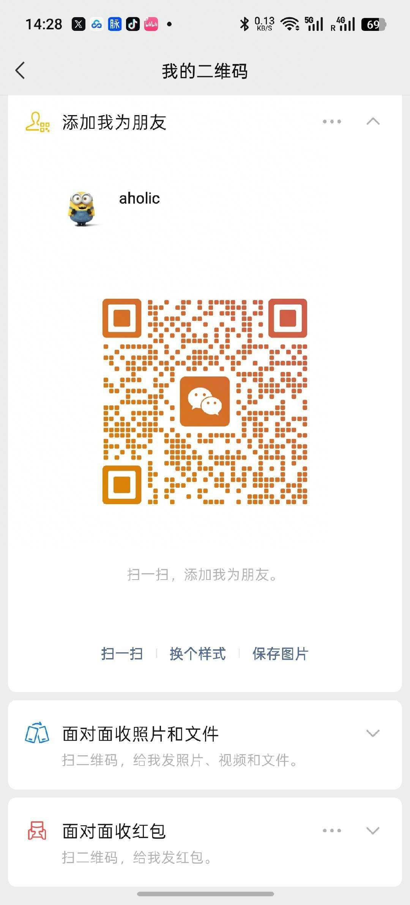

# pi-lessons

基于 [pi-coding-agent](https://www.npmjs.com/package/@earendil-works/pi-coding-agent) 的 Pi Chat 学习项目，包含 React 前端和 Hono 服务端。

## 快速开始

```bash
pnpm install
cp apps/pi-chat/.env.example apps/pi-chat/.env
pnpm dev:pi-chat
```

服务默认监听 `http://127.0.0.1:4328`。

## 配置

`apps/pi-chat/.env` 可设置日志级别、监听地址和端口。模型与 Provider 凭据由本地 Pi 配置管理。

会话、记录和工作区数据默认保存在 `~/.pi/agent/pi-chat`，可通过 `PI_CHAT_ROOT_DIR` 修改。

## 扩展案例

`apps/extensions/` 用于存放独立的 Pi 扩展案例，每个扩展使用单独的子目录和 `package.json`，自动加入 pnpm workspace。

当前包含 [pi-opensandbox](./apps/extensions/pi-opensandbox/README.md)：将 Pi 的文件、搜索和 Shell 工具接入 OpenSandbox，支持可选的 Skill 镜像同步。

```bash
pnpm build:pi-opensandbox
pnpm typecheck:pi-opensandbox
pnpm test:pi-opensandbox
```

## Agentgateway 图片模型路由

[`apps/agentgateway-image-router`](./apps/agentgateway-image-router/README.md) 记录一个按图片请求体 `model` 字段选择上游的轻量服务。它让统一的 `/v1/images/generations` 接口同时支持 `gpt-image-2` 和 Seedream，而不要求客户端发送 provider 分流头。

部署资源已按 Deployment、Service、NetworkPolicy、Backend 和 HTTPRoute 拆开，另附 NewAPI 文本模型池及客户端鉴权的脱敏示例。示例只保留 Secret 引用，不包含凭据值或私人分组、专属 endpoint；使用前需按自己的环境调整。

## Loom：AgentGateway 外挂鉴权与计费

[`apps/loom`](./apps/loom/README.md) 是一个 Go 实现的 AgentGateway `extAuth` + billing 服务：one-api 口径的模型计价表（ConfigMap 主、PG 表兜底）、账户 + Key 两级额度、鉴权阶段原子预扣、遥测阶段幂等结算、Prometheus 指标。部署到 st2-aii 并通过 70 项验收矩阵，见 [运维手册](./docs/loom-extauth-billing.md) 与 [实施计划](./docs/loom-plan.md)。

```bash
cd apps/loom && make test && deploy/deploy.sh --fresh --tag v0.3.0 && deploy/smoke.sh
```

## 安全

不要提交 `.env`、API Key、会话记录或本机路径；提交配置示例时使用占位值。

## 联系与交流

### 个人微信



### 微信群：信使宝宝在教 AI


> 群二维码有有效期，失效后请联系作者获取最新二维码。

## 许可

ISC
